<p align="center">
  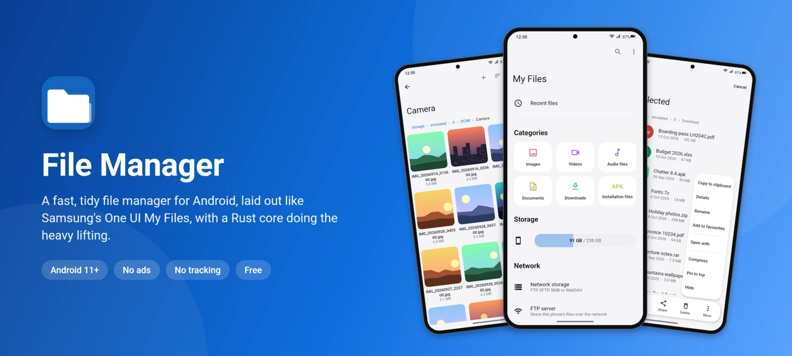
</p>

<p align="center">
  <a href="https://github.com/techhonar/File-Manager/releases/latest"></a>
  <a href="https://github.com/techhonar/File-Manager/releases"></a>
  
  
  
</p>

<h3 align="center"><a href="https://github.com/techhonar/File-Manager/releases/latest">Download the latest APK</a></h3>

<p align="center">
  <a href="#screenshots">Screenshots</a> ·
  <a href="#features">Features</a> ·
  <a href="#install">Install</a> ·
  <a href="#permissions-and-privacy">Privacy</a> ·
  <a href="#faq">FAQ</a> ·
  <a href="#for-developers">For developers</a>
</p>

**File Manager** is a free Android app for finding, sorting and cleaning up the
files on your phone. It looks and works like Samsung's **My Files** - big
titles, rounded cards, a floating action bar - on any phone with Android 11 or
newer. The heavy work, from opening a folder of thousands of photos to
searching the whole phone, is done by a native core written in Rust, so it
stays quick on a phone that is full.

No ads. No tracking. No account.

## Screenshots

<table>
  <tr>
    <td align="center">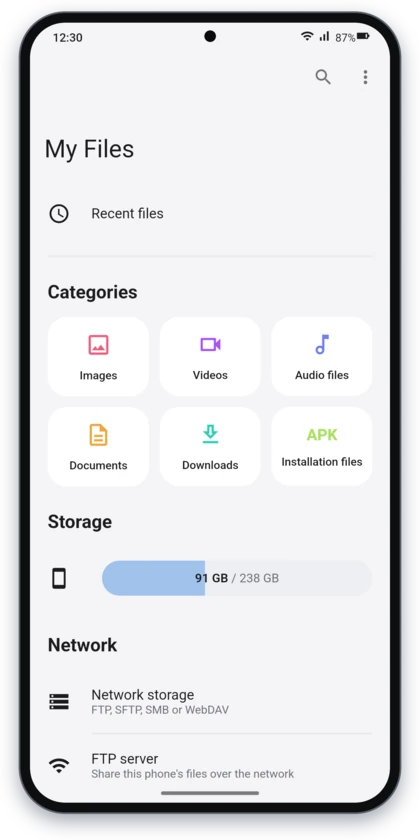<br><sub><b>Everything on one screen</b></sub></td>
    <td align="center">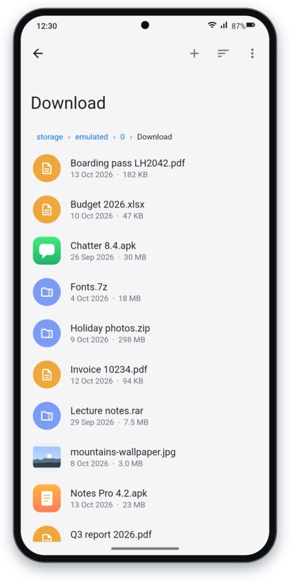<br><sub><b>Folders, with icons that say what's inside</b></sub></td>
    <td align="center">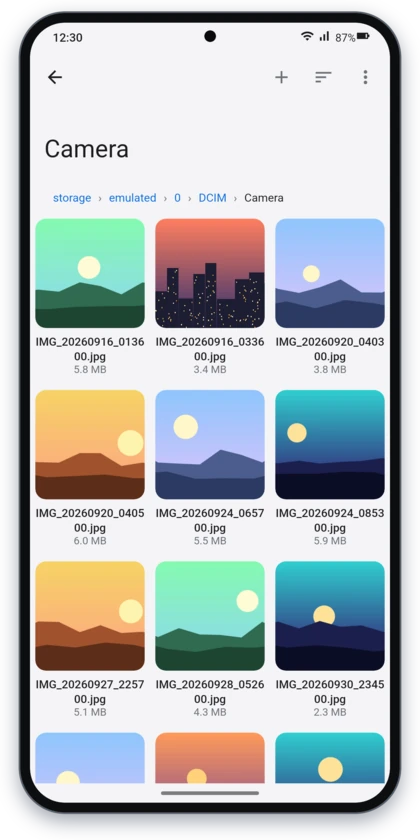<br><sub><b>Grid view for photos and videos</b></sub></td>
    <td align="center">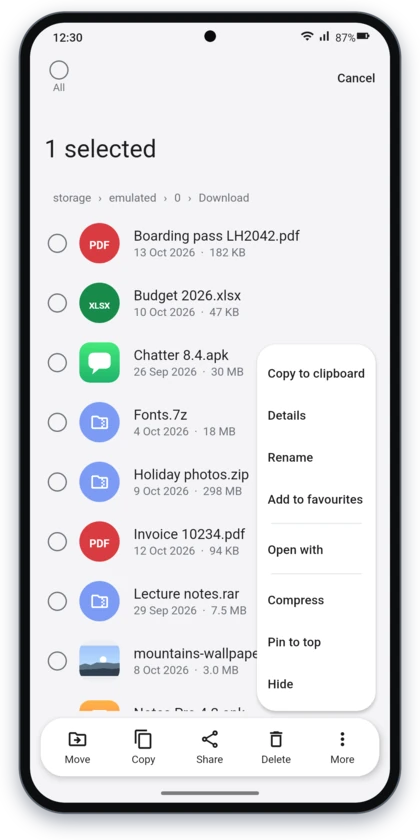<br><sub><b>Select and act, the One UI way</b></sub></td>
  </tr>
  <tr>
    <td align="center">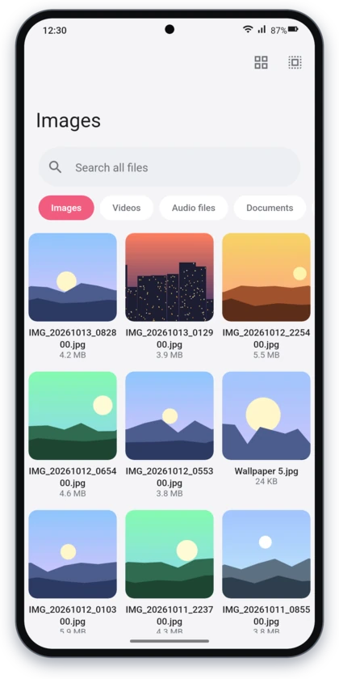<br><sub><b>Categories at a tap</b></sub></td>
    <td align="center">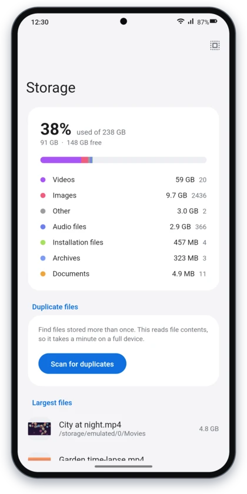<br><sub><b>See what fills your phone</b></sub></td>
    <td align="center">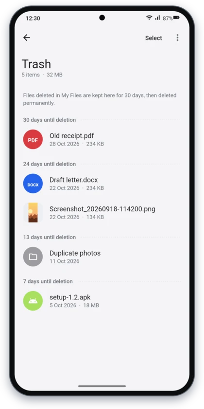<br><sub><b>A trash that gives you 30 days</b></sub></td>
    <td align="center">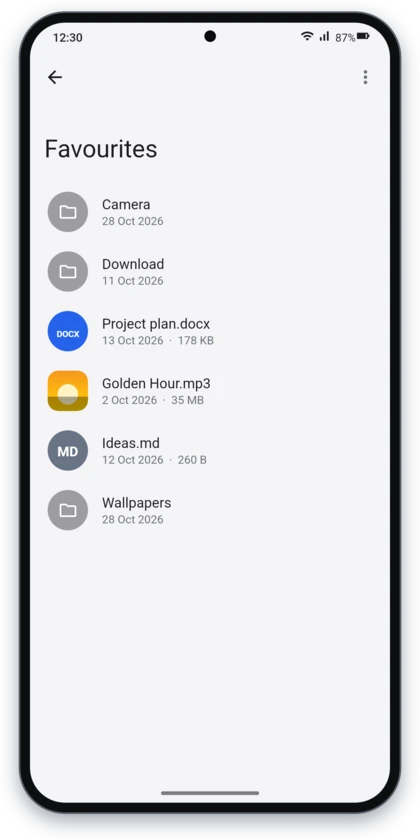<br><sub><b>Favourites, in your order</b></sub></td>
  </tr>
  <tr>
    <td align="center">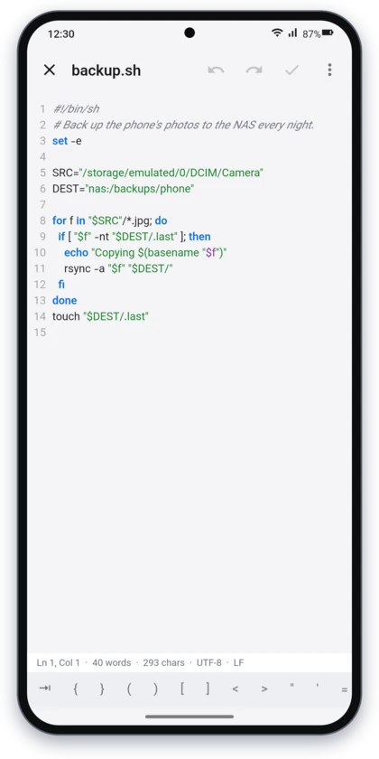<br><sub><b>A real text editor</b></sub></td>
    <td align="center">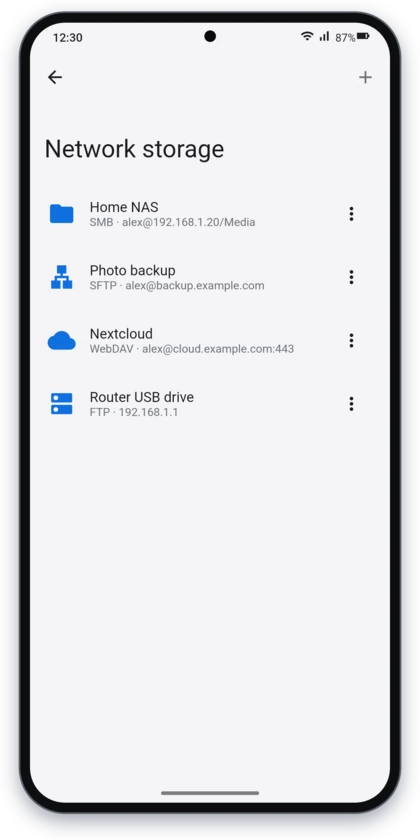<br><sub><b>Your NAS, server or cloud</b></sub></td>
    <td align="center">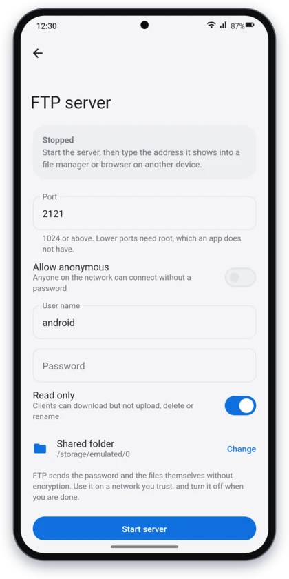<br><sub><b>Built-in FTP server</b></sub></td>
    <td align="center">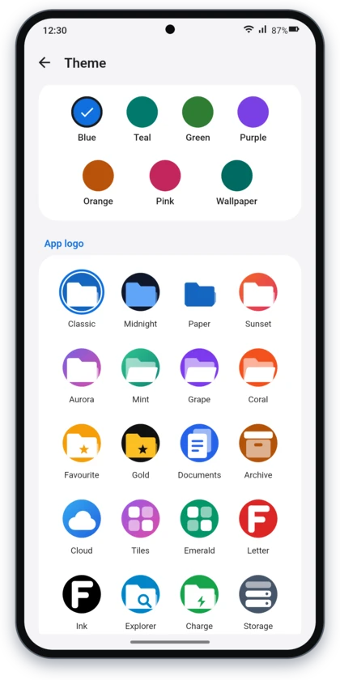<br><sub><b>Your colours, your icon</b></sub></td>
  </tr>
</table>

## Features

### Browse and organise

- **Three layouts** - list, detailed list or grid - and each kind of list remembers its own.
- **Sort** by name, date, size or type, with folders kept on top.
- **Copy, move, rename, delete and share**; create folders and text files; **pin** things to the top of a folder; **hide** what you don't want to see.
- **Select like One UI**: hold a file to start, tap to add more, or tick *All*. The bar at the bottom moves, copies, shares or deletes, and *More* has Copy to clipboard, Details, Rename, Add to favourites, Open with, Show in folder, Compress, Pin to top and Hide.
- **Details** for one file or many at once: the total size including everything inside folders, what they contain, when they were changed, and which app made a file.
- **Favourites** you can put in any order by dragging, and **Recent files** from the past week.

### Find anything, fast

- **Categories** - Images, Videos, Audio files, Documents, Downloads and Installation files - open straight to their files, and remember what they found for next time.
- **Search** the whole phone by name, with results appearing as they are found.
- **Real thumbnails**: photos, video frames, album covers, and the icon inside every APK.

### Free up space

- **Storage** shows how much each kind of file takes, and your largest files.
- **Duplicate finder** compares what is inside files to find the copies.
- **Trash** keeps deleted files for 30 days, so a mistake can be undone.

### Archives and app installers

- **Open and extract** ZIP, 7z, RAR and TAR archives, plain or compressed (gz, bz2, xz, zst), password-protected ones included.
- **Compress** files and folders into a ZIP, with a password if you like.
- **Install apps** by tapping an `.apk`, or an `.xapk`, `.apks` or `.apkm` bundle.

### Network

- **Network storage**: browse FTP, FTPS, SFTP, SMB (Windows shares and NAS boxes) and WebDAV (such as Nextcloud). Downloads and uploads carry on in the background, with their progress in a notification.
- **FTP server**: reach the phone's files from a computer on the same Wi-Fi. Read-only unless you say otherwise, with a password or open to anyone, sharing the folder you choose.

### View and edit

- **A viewer of its own** for PDF, Word (`.docx`) and more than 40 kinds of text and code files.
- **A text editor** with syntax colours, line numbers, word wrap, find and replace, go to line, undo and redo, text size, encoding and line endings, and Save as.

### Make it yours

<table>
  <tr>
    <td align="center">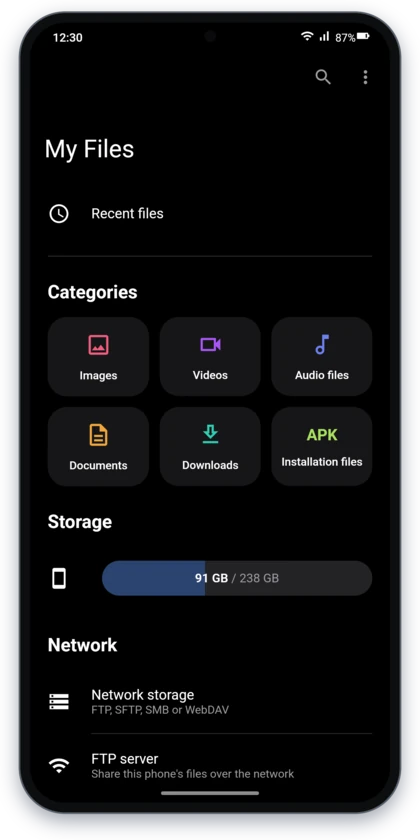</td>
    <td align="center">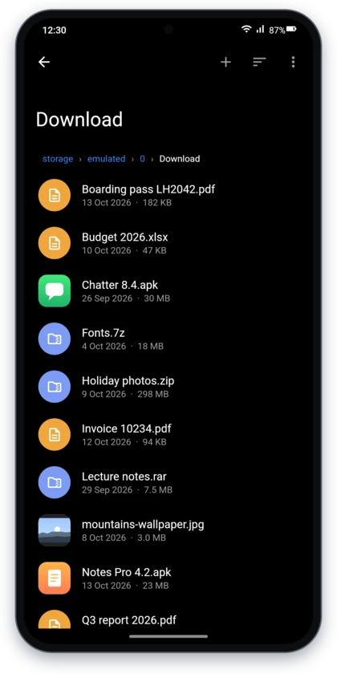</td>
    <td align="center">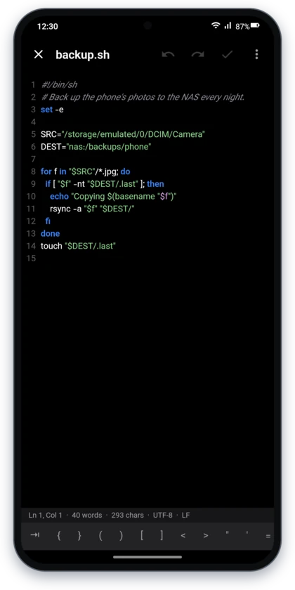</td>
    <td align="center">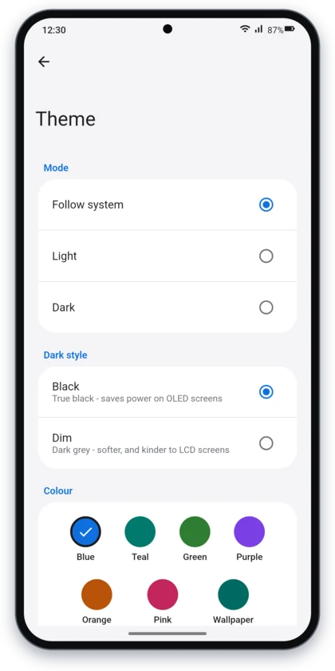</td>
  </tr>
</table>

- **Light, dark or follow the system**, with a true-black dark style for OLED screens or a softer dim one.
- **Accent colours**, your wallpaper's colours on Android 12 and newer, or any colour you pick by hand.
- **20 app icons** to choose from.

### Fits into Android

- **Your phone's file manager**: it can open folders and the Downloads notification for other apps.
- **The file picker for other apps**: when an app asks you to choose a file, File Manager can do the choosing.
- **Default apps** shows which app opens folders, PDFs and the rest, and helps you change it.

### Always up to date

- It checks for a new version every 10 minutes and says so in a notification that lists what changed. **Update App** in the menu downloads it and opens the installer.

## Install

**You need:** Android 11 or newer, on a 64-bit phone - which is nearly every phone made in the last several years.

1. On your phone, open the [latest release](https://github.com/techhonar/File-Manager/releases/latest) and download `FileManager-<version>.apk`.
2. Open the downloaded file. If Android asks, allow your browser to *install unknown apps*, then tap **Install**.
3. Open **File Manager** and tap **Grant access**. On the settings page that opens, turn on **Allow access to manage all files**, then come back.

The app is not on Google Play; every version is published here, on the [Releases](https://github.com/techhonar/File-Manager/releases) page.

### Updating

When a new version is out, a notification tells you what changed - tap it, or
use **⋮ → Update App**. The new version installs over the old one, and your
files, favourites and settings stay as they are.

## Permissions and privacy

| Permission | What it is for |
| --- | --- |
| All files access | Seeing and managing the files on your phone - the point of a file manager |
| Internet and network state | Checking for updates, network storage and the FTP server |
| Notifications | Update notices, transfer progress, and showing that the FTP server is on |
| Foreground service | Keeping transfers and the FTP server going when you leave the app |
| Install apps | Installing the APKs and bundles you tap, and the app's own updates |
| Run at startup | Scheduling the update check again after the phone restarts |

- **No ads, no analytics, no account.** There are no tracking libraries in the app.
- **The only connection it makes on its own** is to GitHub's public API, to check for a new version.
- **Network storage logins** stay on your phone.
- **Deleted files** go to a hidden `.FileManagerTrash` folder on the phone, and are gone for good after 30 days.

## FAQ

**Why does it need All files access?**
Android shows a file manager your folders - Download, DCIM, Documents and the
rest - only with that permission. Without it, the app could see only the files
other apps hand to it.

**Is it on Google Play?**
No. Download it from the [Releases](https://github.com/techhonar/File-Manager/releases) page.

**Can it replace my phone's file manager?**
Yes. Open **⋮ → Default apps** to make it the app that opens folders and downloads.

**Does it work with SD cards?**
Yes. A card that is in the phone appears on the home screen next to internal storage.

**I deleted something by mistake.**
Open **Trash** on the home screen, select it and tap **Restore**.

**Is this made by Samsung?**
No. It follows the look of Samsung's One UI, but it is an independent project,
not affiliated with or endorsed by Samsung.

## For developers

### How it is built

The interface is **Kotlin** with **Jetpack Compose**; everything that touches
many files at once is **Rust**, in `rust-core/`.

| Rust (`rust-core/`) | Kotlin (`app/`) |
| --- | --- |
| Folder listings, sizes and copies, in parallel | Jetpack Compose UI in the One UI style |
| Search and the category scans | Permissions, MediaStore, intents |
| Storage analysis and duplicate detection (blake3) | Navigation and screen state |
| ZIP, 7z, RAR and TAR, with their passwords | Thumbnails, through Coil |
| The trash: move, restore, purge | Network storage clients and the FTP server |

The two talk through [UniFFI](https://mozilla.github.io/uniffi-rs/): types and
functions are declared once in Rust, and the Kotlin bindings are generated at
build time - there is no hand-written JNI.

```rust
// rust-core/src/scanner.rs
#[uniffi::export]
pub fn list_dir(path: String, show_hidden: bool, sort: SortOptions) -> Result<Vec<FileEntry>>
```

```kotlin
// generated, never edited
fun listDir(path: String, showHidden: Boolean, sort: SortOptions): List<FileEntry>
```

### Building

You need JDK 21, the Android SDK (platform 35, with the **NDK**), and Rust
installed through `rustup` with the Android targets:

```bash
rustup target add aarch64-linux-android x86_64-linux-android
cargo install cargo-ndk
```

The Gradle wrapper's JAR is not committed. Open the project in Android Studio,
which provides it, or use Gradle 8.11.1 directly:

```bash
gradle assembleDebug        # builds the Rust core, generates the bindings, builds the APK
gradle installDebug         # installs it on a connected phone or emulator
```

The Rust core is tested on its own, natively - no phone or emulator needed:

```bash
cd rust-core && cargo test
```

### Project layout

```
rust-core/src/      the native core: scanner, search, session, categories,
                    storage, dedup, archive, trash, walk, types, errors
app/src/main/java/com/filemanager/app/
  data/             FileRepository (the only place Kotlin calls Rust), settings,
                    thumbnails, and the editor, external, ftpd, install, remote,
                    transfer, update and viewer packages
  viewmodel/        one view model per screen
  ui/               screens, components and the One UI theme
tools/              app_logos.py (draws the 20 logos), release_notes.py
.github/workflows/  release.yml
```

### Releases

Pushing a `v*` tag runs `.github/workflows/release.yml`: it builds the Rust
core for `arm64-v8a` and `x86_64`, runs its tests, builds a signed APK and
publishes it as a GitHub Release, with notes written by
`tools/release_notes.py`.

```bash
git tag v1.2.3
git push origin v1.2.3
```

`versionName` comes from the tag (`v1.2.3` builds `1.2.3`), and `versionCode`
from the workflow's run number, so it always goes up - Android refuses an
update whose `versionCode` is not higher than the installed one. A manual run
(*Actions → Run workflow*) builds an APK and keeps it as a build artifact.

The release notes group changes by the name of the branch they were merged
from: `feat/` is a new feature, `fix/` a fix, `perf/` a speed-up, and `docs/`,
`chore/`, `ci/` or `build/` are behind the scenes.

#### Signing

Releases are signed with a key kept in the repository's secrets. A tag pushed
without them fails on purpose, rather than publishing something signed with a
key that changes every time; a manual run without them signs with a throwaway
key, which installs but cannot update a real release.

Create the key once (`keytool` comes with the JDK) and keep `release.jks` safe
and **out of the repository**: losing it means no update can ever reach anyone
who installed an earlier APK.

```bash
keytool -genkeypair -v -keystore release.jks -alias filemanager \
  -keyalg RSA -keysize 4096 -validity 10000
```

Then add four secrets under *Settings → Secrets and variables → Actions*:

| Secret | Value |
| --- | --- |
| `KEYSTORE_BASE64` | the output of `base64 -w0 release.jks` |
| `KEYSTORE_PASSWORD` | the keystore's password |
| `KEY_ALIAS` | `filemanager` |
| `KEY_PASSWORD` | the key's password |

## Built with

[Jetpack Compose](https://developer.android.com/compose) ·
[Coil](https://coil-kt.github.io/coil/) ·
[UniFFI](https://github.com/mozilla/uniffi-rs) ·
[rayon](https://github.com/rayon-rs/rayon) ·
[walkdir](https://github.com/BurntSushi/walkdir) ·
[zip](https://github.com/zip-rs/zip2) ·
[sevenz-rust2](https://github.com/hasenbanck/sevenz-rust) ·
[unrar](https://github.com/muja/unrar.rs) ·
[Apache FtpServer](https://mina.apache.org/ftpserver-project/) ·
[Apache Commons Net](https://commons.apache.org/proper/commons-net/) ·
[sshj](https://github.com/hierynomus/sshj) ·
[smbj](https://github.com/hierynomus/smbj) ·
[OkHttp](https://square.github.io/okhttp/) ·
[JNA](https://github.com/java-native-access/jna)

RAR archives are read with RARLAB's UnRAR, built from source by the `unrar`
crate. Its licence lets an app use it for free, but it is not an open-source
licence, which rules out stores that accept only open-source code.

<sub>The screenshots show the app's own screens rendered from its code, over
sample files. Samsung, One UI and Galaxy are trademarks of Samsung Electronics;
this project is not affiliated with Samsung.</sub>
